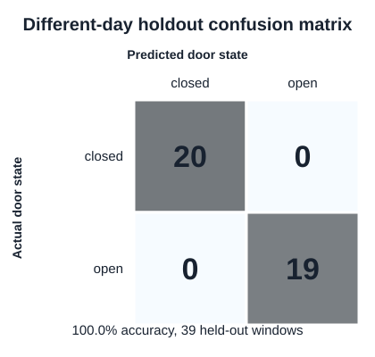
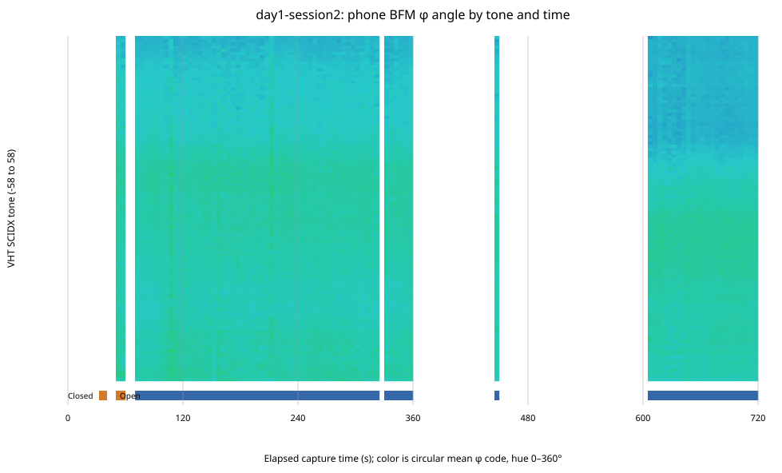
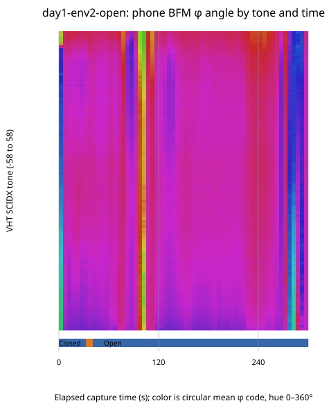
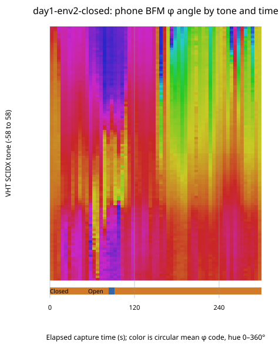

# Door-State Sensing from Wi-Fi Beamforming Feedback: A Feasibility Study

**Draft status:** final results incorporated. The reportable result is a different-day holdout using four five-minute captures collected on 24 November 2026. The raw capture files remain local and excluded from the repository.

## Abstract (provisional)

Wi-Fi beamforming feedback (BFM) is generated when a client reports channel information to an access point for transmit beamforming. This project investigates whether angle values decoded from BFM sent by an author's iPhone can distinguish an open door from a closed door. We implemented passive capture with an Intel AX211 monitor interface and extracted VHT compressed beamforming reports sent to a Ruckus access point. The final derived dataset contains the original 11,364 labeled reports and 10,794 newly collected reports in four five-minute single-state captures from a second day. A standardized nearest-centroid baseline trained on 75 windows from 23 November and tested on 39 windows from 24 November classified all held-out windows correctly: 20 closed and 19 open. The result is limited by separate single-state capture blocks and one phone/AP deployment, but it demonstrates a reproducible, session-held-out BFM door-state baseline.

## 1. Introduction

Wi-Fi sensing uses changes in wireless channel measurements to infer physical conditions. CSI-based work has shown that Wi-Fi can capture subtle physiological signals, including breathing and heartbeat, for authentication (Li et al. 2026). Beamforming feedback offers a related sensing source: the client computes a compressed representation of the channel and returns it to the access point during ordinary sounding. BFMSense demonstrated sensing from BFM, including walking and breathing (Yi et al. 2024). BFMScan showed how to reconstruct angle-resolved profiles from compressed BFM and use them to distinguish target directions and motion (Li et al. 2026).

This project studies a modest binary task: classify whether a nearby door is open or closed from BFM sent by the author's own phone. The hypothesis is that the door changes the multipath channel between the access point and phone, which may alter the reported angle profile. A useful evaluation must distinguish the door effect from phone traffic, device placement, and time/session effects.

## 2. Background and Related Work

CSI is estimated by Wi-Fi receivers and varies with environmental changes. 2FiA demonstrates the sensitivity of CSI for biometric inference (Li et al. 2026). BFM is different: it is a compressed channel representation sent by a beamformee after an AP sounding exchange. BFMSense established BFM as a practical sensing signal in commodity Wi-Fi (Yi et al. 2024). BFMScan develops an angle-resolved reconstruction pipeline for BFM (Li et al. 2026). This project uses Wireshark's VHT compressed beamforming dissector to extract per-tone φ and ψ values and tests a simple door-state classifier.

## 3. Data Collection

### 3.1 Equipment and setup

The sniffer is an Ubuntu laptop with an Intel AX211 Wi-Fi 6E adapter using the `iwlwifi` driver. In-place conversion of the station interface did not reliably deliver frames. The working setup creates a separate `mon0` virtual monitor interface on `phy0`. Captures were made on channel 44 (primary 5220 MHz) with an 80 MHz monitor channel centered at 5210 MHz. The beamforming reports identify a Ruckus AP and the author's iPhone as beamformee. The monitor capture remains local; derived data includes only the author's phone BFM.

The monitor radio width and the VHT report's indicated bandwidth are distinct. The inspected phone reports decode as VHT compressed feedback; nearly all carry 108 tone entries and one captured report had 52 tone entries. These correspond to different report bandwidth codes in Wireshark's dissector and are retained as a per-report field.

### 3.2 Sessions and labels

The original three 12-minute captures and four five-minute captures were collected on 23 November 2026. Session 1 used a different AP radio from sessions 2 and 3, and its only door note is “45: closed door.” That point observation does not establish the door state over an interval, so session 1 is retained as unlabeled data and excluded from the model windows. Sessions 2 and 3 use one recorded transition each. Four additional captures record one reported door state per file:

| Session | Recorded label timeline | Extracted labeled BFM reports after 5 s transition margin |
|---|---|---:|
| Day 1, session 2 | Closed 0–65 s; open 65–720 s (assumes no later change) | 648: 4 closed, 644 open |
| Day 1, session 3 | Open 0–83 s; closed 83–720 s (assumes no later change) | 1,636: 76 open, 1,560 closed |
| Day 1, env1 open | Open for 5 minutes | 1,504 |
| Day 1, env1 closed | Closed for 5 minutes | 3,183 |
| Day 1, env2 open | Open for 5 minutes | 2,303 |
| Day 1, env2 closed | Closed for 5 minutes | 2,090 |
| Day 3, pair 1 open | Open for 5 minutes | 2,577 |
| Day 3, pair 1 closed | Closed for 5 minutes | 3,106 |
| Day 3, pair 2 open | Open for 5 minutes | 2,341 |
| Day 3, pair 2 closed | Closed for 5 minutes | 2,770 |

The four new capture labels come from the user's state notes and filenames. Env1's open and closed files use different Ruckus AP radios; env2 uses the same radio for both states. This AP mismatch is a confound for env1. The raw PCAP files remain local because they can contain surrounding apartment Wi-Fi traffic.

## 4. Method

The extractor selects VHT compressed beamforming reports by frame subtype and the locally supplied phone transmitter and AP receiver addresses. It parses each report's SCIDX, φ11, and ψ21 values and maps the quantized angle codes to degrees. MAC addresses are used only as local filters and are not written to derived data.

For exploratory modeling, reports are grouped into non-overlapping 30-second windows. Per-report features summarize circular φ and ψ behavior over the lower and upper halves of the tone sequence; window features aggregate these summaries. Windows with fewer than five reports or less than 80% label purity are dropped. A nearest-centroid baseline standardizes using only the training session and holds out an entire session.

## 5. Results and Evaluation

The capture pipeline reported 389,492 packets with zero drops for session 1, 827,793 packets with zero drops for session 2, and approximately 925,000 packets for session 3; all available dumpcap summaries reported zero drops. The three project captures produced 916, 655, and 1,667 iPhone BFM reports, respectively; session 1 is unlabeled. The parser retained 648 and 1,636 reports in sessions 2 and 3 after excluding transition margins. Session 1 also yielded 78 NDPA frames overall, but this count is not treated as a door-state label or model result.

The final 30-second dataset contains 114 windows. The reportable split trains only on 75 windows from 23 November and holds out all 39 windows from the four 24 November captures. Training has 39 closed and 36 open windows; test has 20 closed and 19 open windows. The test captures use the same observed Ruckus BSSID and the same phone transmitter address. The standardized nearest-centroid baseline yields the confusion matrix below (actual rows, predicted columns): closed [20, 0] and open [0, 19], for 39/39 correct (100.0%).

The older capture-level leave-one-session-out diagnostic remains variable because many individual captures contain only one class. It is retained in `data/derived/final_loso.json` as a failure and generalization diagnostic, not as the reported result.

Session 1's heatmap is descriptive only. The “45: closed door” note is a point observation and is not used to label a time interval.

## 6. Limitations

The final holdout uses a different day, but each file still contains a single state. Time, traffic intensity, and unrecorded environmental changes can therefore correlate with the label. The experiment also uses one iPhone, one Ruckus BSSID, and one apartment geometry; it does not show cross-device or cross-location generalization. Report rates vary with traffic and sounding behavior. A stronger follow-up would alternate states within each capture while recording every transition, repeat the protocol over more days, and evaluate on a separately collected balanced day.

## 7. Conclusion

The work verifies that an Intel AX211 with a separate monitor interface can capture the author's phone's VHT BFM and that per-tone angles can be extracted. A 23-to-24 November session-held-out test achieved 100.0% accuracy on 39 balanced windows. This is promising evidence for this deployment, while the single-state capture blocks and single-location setup limit the claim to a feasibility study. The repository provides the labeled derived data, capture and recovery scripts, feature pipeline, evaluation output, and figures needed to reproduce the result.

## References

Li, Bofan, Zhankai Ye, Weikuan Yu, Yongning Tang, and Xin Liu. 2026. “2FiA: Towards WiFi Sensing-Based Authentication with Unique Biometrics.” IEEE Symposium on Security and Privacy.

Yi, Enze, Dan Wu, Jie Xiong, Fusang Zhang, Kai Niu, Wenwei Li, and Daqing Zhang. 2024. “BFMSense: WiFi Sensing Using Beamforming Feedback Matrix.” USENIX NSDI.

Li, Bofan, Zhuoyuan Liu, Zhankai Ye, Weikuan Yu, and Xin Liu. 2026. “BFMScan: Enabling Explicit Angle-Resolved Sensing via Beamforming Feedback Matrix.” IMWUT/UbiComp.
