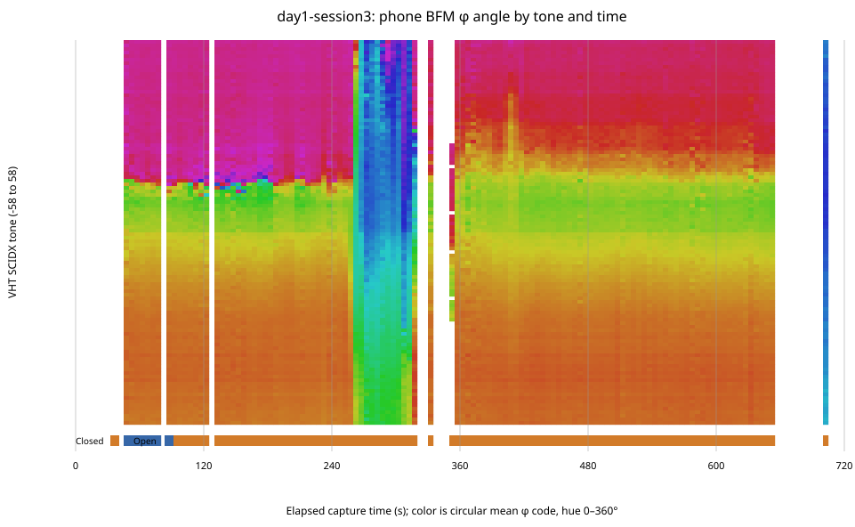
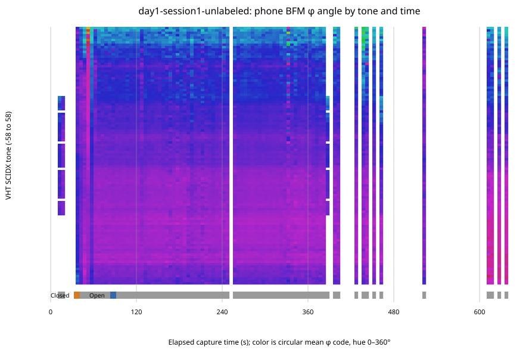

# Door-State Sensing from Wi-Fi Beamforming Feedback: A Feasibility Study

**Draft status:** exploratory. Do not submit this manuscript until additional balanced, labeled sessions and a valid session-held-out evaluation are complete.

## Abstract (provisional)

Wi-Fi beamforming feedback (BFM) is generated when a client reports channel information to an access point for transmit beamforming. This project investigates whether angle values decoded from BFM sent by an author's iPhone can distinguish an open door from a closed door. We implemented passive capture with an Intel AX211 monitor interface and extracted VHT compressed beamforming reports sent to a Ruckus access point. Three 12-minute captures from one day provide 3,238 phone BFM reports, of which 916 currently have no interval label. The two interval-labeled sessions are highly imbalanced within each session and are from the same day; a session-held-out diagnostic therefore cannot provide a credible estimate of door-state classification performance. The present work establishes a capture and decoding pipeline and identifies the need for balanced, multi-day collection before drawing sensing conclusions.

## 1. Introduction

Wi-Fi sensing uses changes in wireless channel measurements to infer physical conditions. CSI-based work has shown that Wi-Fi can capture subtle physiological signals, including breathing and heartbeat, for authentication (Li et al. 2026). Beamforming feedback offers a related sensing source: the client computes a compressed representation of the channel and returns it to the access point during ordinary sounding. BFMSense demonstrated sensing from BFM, including walking and breathing (Yi et al. 2024). BFMScan showed how to reconstruct angle-resolved profiles from compressed BFM and use them to distinguish target directions and motion (Li et al. 2026).

This project studies a modest binary task: classify whether a nearby door is open or closed from BFM sent by the author's own phone. The hypothesis is that the door changes the multipath channel between the access point and phone, which may alter the reported angle profile. A useful evaluation must distinguish the door effect from phone traffic, device placement, and time/session effects.

## 2. Background and Related Work

CSI is estimated by Wi-Fi receivers and varies with environmental changes. 2FiA demonstrates the sensitivity of CSI for biometric inference (Li et al. 2026). BFM is different: it is a compressed channel representation sent by a beamformee after an AP sounding exchange. BFMSense established BFM as a practical sensing signal in commodity Wi-Fi (Yi et al. 2024). BFMScan develops an angle-resolved reconstruction pipeline for BFM (Li et al. 2026). This project uses Wireshark's VHT compressed beamforming dissector to extract per-tone φ and ψ values and tests a simple door-state classifier.

## 3. Data Collection

### 3.1 Equipment and setup

The sniffer is an Ubuntu laptop with an Intel AX211 Wi-Fi 6E adapter using the `iwlwifi` driver. In-place conversion of the station interface did not reliably deliver frames. The working setup creates a separate `mon0` virtual monitor interface on `phy0`. Captures were made on channel 44 (primary 5220 MHz) with an 80 MHz monitor channel centered at 5210 MHz. The beamforming reports identify a Ruckus AP and the author's iPhone as beamformee. The monitor capture remains local; derived data includes only the author's phone BFM.

The monitor radio width and the VHT report's indicated bandwidth are distinct. The inspected phone reports decode as VHT compressed feedback; nearly all carry 108 tone entries and one captured report had 52 tone entries. These correspond to different report bandwidth codes in Wireshark's dissector and are retained as a per-report field.

### 3.2 Sessions and labels

Three raw 12-minute captures are now available locally. All were collected on 23 November 2026. Session 1 used a different AP radio from sessions 2 and 3, and its only door note is “45: closed door.” That point observation does not establish the door state over a surrounding interval, so session 1 is retained as unlabeled data and excluded from the model windows. The supplied notes indicate one transition per interval-labeled session:

| Session | Recorded label timeline | Extracted labeled BFM reports after 5 s transition margin |
|---|---|---:|
| Day 1, session 2 | Closed 0–65 s; open 65–720 s (assumes no later change) | 648: 4 closed, 644 open |
| Day 1, session 3 | Open 0–83 s; closed 83–720 s (assumes no later change) | 1,636: 76 open, 1,560 closed |

These labels are preliminary and should be corrected if any additional door transitions occurred. Captures were performed while the phone generated downlink traffic. The raw PCAP files are excluded from this repository because they contain surrounding apartment Wi-Fi traffic.

## 4. Method

The extractor selects VHT compressed beamforming reports by frame subtype and the locally supplied phone transmitter and AP receiver addresses. It parses each report's SCIDX, φ11, and ψ21 values and maps the quantized angle codes to degrees. MAC addresses are used only as local filters and are not written to derived data.

For exploratory modeling, reports are grouped into non-overlapping 30-second windows. Per-report features summarize circular φ and ψ behavior over the lower and upper halves of the tone sequence; window features aggregate these summaries. Windows with fewer than five reports or less than 80% label purity are dropped. A nearest-centroid baseline standardizes using only the training session and holds out an entire session.

## 5. Preliminary Results and Evaluation Status

The capture pipeline reported 389,492 packets with zero drops for session 1, 827,793 packets with zero drops for session 2, and approximately 925,000 packets for session 3; all available dumpcap summaries reported zero drops. The three project captures produced 916, 655, and 1,667 iPhone BFM reports, respectively; session 1 is unlabeled. The parser retained 648 and 1,636 reports in sessions 2 and 3 after excluding transition margins. Session 1 also yielded 78 NDPA frames overall, but this count is not treated as a door-state label or model result.

The present data cannot support a final accuracy claim. The 30-second dataset contains 35 windows: 14 open windows from session 2, and 19 closed plus 2 open windows from session 3. In leave-one-session-out diagnostics, one fold tests only the open class; the other fold is skipped because its training session lacks usable windows from both classes. The tested fold's 0/14 accuracy is a diagnostic of the invalid split/data balance, not evidence that the sensing hypothesis fails or succeeds. A balanced, multi-day dataset is needed before model comparison or final evaluation.

Session 1's heatmap is descriptive only. The “45: closed door” note is a point observation and is not used to label a time interval.

## 6. Limitations and Next Experiments

The captures are from one day, and each available session contains a single recorded state transition. Door state is consequently strongly confounded with session and time, and some end-of-session labels are assumed. The report counts also vary with traffic and sounding behavior. The next experiment should alternate open and closed states in repeated balanced blocks, record each transition time, preserve phone/AP geometry and workload, and repeat on a different day. Evaluation should hold out whole sessions or days, report class counts and a confusion matrix, and discuss failure cases.

## 7. Conclusion

The work verifies that an Intel AX211 with a separate monitor interface can capture the author's phone's VHT BFM and that per-tone angles can be extracted. It does not yet establish reliable door-state classification. The current contribution is a reproducible capture and extraction pipeline plus a documented collection gap; model claims await balanced multi-session data.

## References

Li, Bofan, Zhankai Ye, Weikuan Yu, Yongning Tang, and Xin Liu. 2026. “2FiA: Towards WiFi Sensing-Based Authentication with Unique Biometrics.” IEEE Symposium on Security and Privacy.

Yi, Enze, Dan Wu, Jie Xiong, Fusang Zhang, Kai Niu, Wenwei Li, and Daqing Zhang. 2024. “BFMSense: WiFi Sensing Using Beamforming Feedback Matrix.” USENIX NSDI.

Li, Bofan, Zhuoyuan Liu, Zhankai Ye, Weikuan Yu, and Xin Liu. 2026. “BFMScan: Enabling Explicit Angle-Resolved Sensing via Beamforming Feedback Matrix.” IMWUT/UbiComp.
